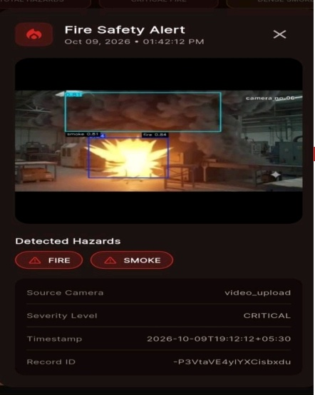
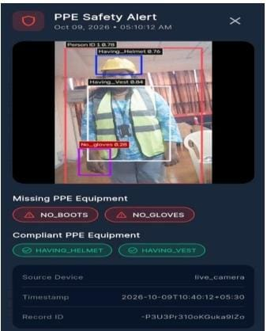
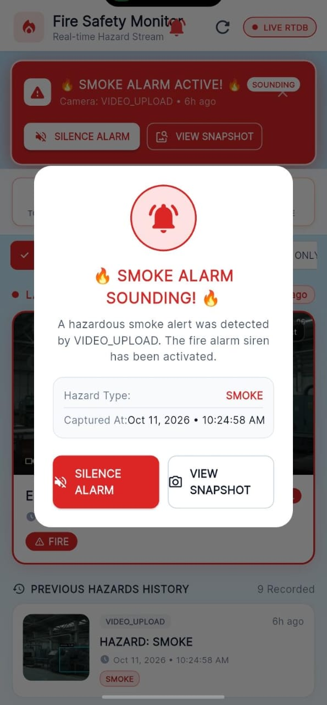
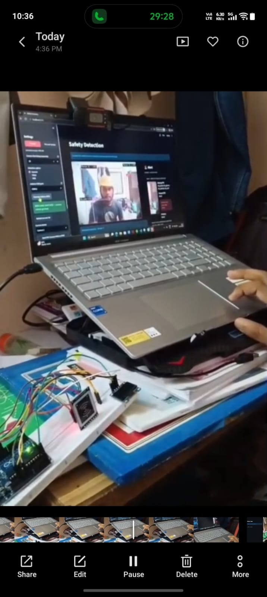
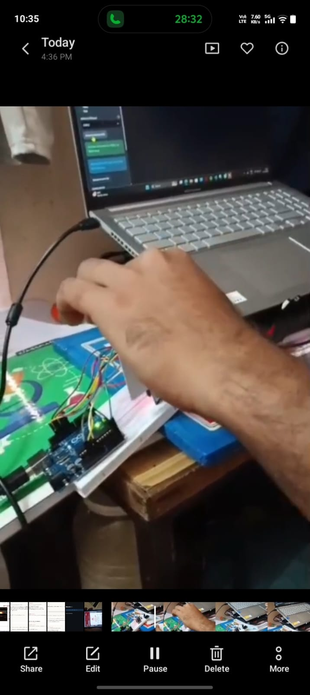
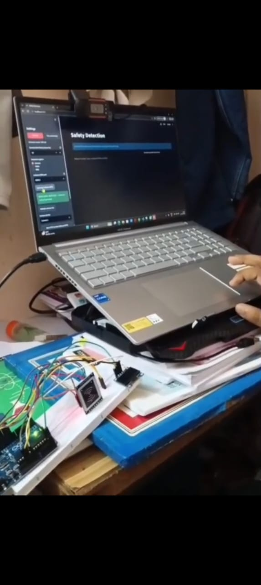
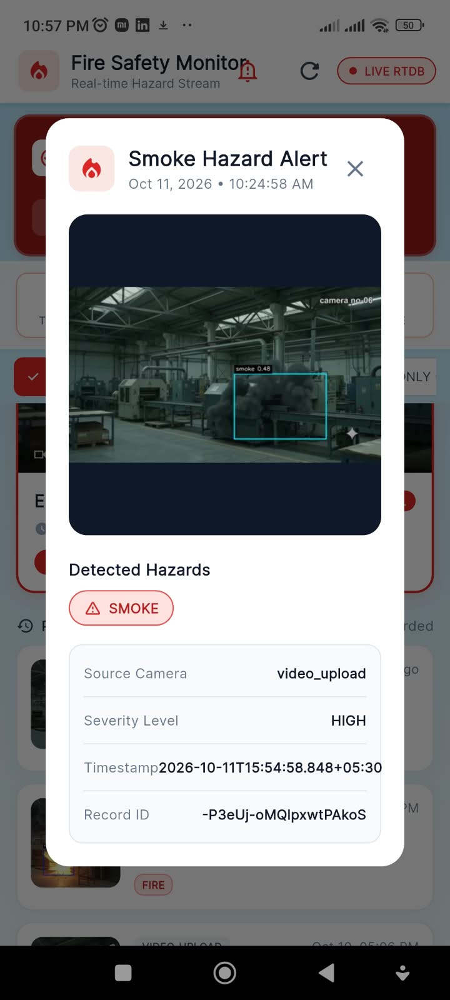
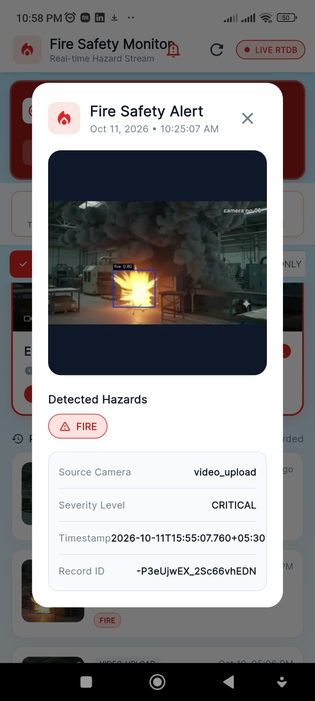

# Safety Detection

A Streamlit application for PPE kit or fire and smoke detection using the corresponding YOLO model.

## Demo

### Sample images

| | |
|---|---|
|  |  |
|  |  |
|  |  |
|  |  |

### Sample video

[Watch the demo video](video1.mp4)

## Prerequisites

- Python (>=3.8)
- `best.pt` for PPE kit detection.
- `best_smoke_fire.pt` for fire and smoke detection.

The project folder includes a `.venv` virtual environment. Virtual environments can contain paths tied to the computer where they were created, so a restored copy may need to be recreated. If activation or Python reports that its interpreter cannot be found, run these commands in PowerShell from the project folder (this recreates `.venv` and installs the project dependencies):

```powershell
py -m venv --clear .venv
.\.venv\Scripts\Activate.ps1
python -m pip install -r requirements.txt
```

## Running the App

1. Place `best.pt` and `best_smoke_fire.pt` in the project directory.
2. Activate the project's virtual environment and start the Streamlit server:

```powershell
.\.venv\Scripts\Activate.ps1
streamlit run app.py
```

3. Open our browser to `http://localhost:8501` (Streamlit will display the URL).

## Detection options

- Choose **PPE Kit** or **Fire and Smoke** to select the detection model.
- **Camera**: run live detection using a camera connected to the computer running Streamlit.
- **Video**: upload a video and download the annotated output.
- **Web**: access a camera connected to the device opening the app, through the browser. Click **Start**, allow browser camera access, then click **Select Device** to choose the external camera once; the browser remembers it as the default for Web detection.
- Adjust the confidence threshold from the sidebar.

## Alerts and Firebase

The **Alert Dashboard** displays timestamped detections with an image snapshot:

- **RFID and PPE camera startup:** In PPE mode, connect the Arduino RFID reader and scan a registered employee card. A matching tag unlocks and automatically starts the PPE camera for a 15-second session. The web dashboard then shows the worker's PPE status and, when equipment is missing, an alert with a snapshot. RFID access is for the PPE camera; it does not start fire/smoke detection.
- **Smoke and fire:** When either hazard is detected in the live camera, browser camera, or an uploaded video, the app records it in the dashboard. With Firebase configured, it saves the event and JPEG snapshot under the Realtime Database `ppe_alerts` node and sends a Firebase Cloud Messaging notification to the `fire_safety_alerts` topic. The notification includes the hazard, time, and source; its record ID can be used to find the saved snapshot.
- **PPE compliance:** The app tracks each detected worker and checks for a helmet, vest, boots, and gloves. Missing equipment is shown in a PPE alert with the items detected and missing, plus a worker snapshot. Workers with all four items detected are marked compliant in the dashboard. Missing-PPE alerts are sent to the `ppe_safety_alerts` topic when Firebase is configured.

For live camera alerts, the configurable **Camera Alert Delay** gives the camera a warm-up period before alerts are generated; it defaults to 10 seconds and can be set to 0 for alerts to begin without that delay. Fire/smoke monitoring must be started separately by selecting **Fire and Smoke** and starting the camera. Once an alert is generated, it appears in the web dashboard and is sent to Firebase for delivery to subscribed mobile clients. To sound a buzzer on a phone, the mobile app must subscribe to the appropriate topic and configure its notification channel with sound; the server sends the push but does not control the phone's buzzer or sound settings.

Devices or apps that should receive push notifications need to subscribe to the corresponding Firebase Cloud Messaging topic. Without valid Firebase credentials, alerts and snapshots still appear in the current session's dashboard, but are not saved remotely and no push notifications are sent.

Install dependencies from `requirements.txt`, including `firebase-admin`. The app prefers `minniepro-e2b29-firebase-adminsdk-fbsvc-791c9195cb.json` when it is present, or you can set `FIREBASE_CREDENTIALS` to another service-account path. The database URL defaults to `https://minniepro-e2b29-default-rtdb.firebaseio.com`; override it with `FIREBASE_DATABASE_URL` if our Firebase Realtime Database uses a different URL.

## Notes

- In live mode, the camera must be connected to the computer running Streamlit. The app detects available OpenCV camera indexes and prefers index 1 when available; select another detected camera from the sidebar or refresh the list after connecting a device.
- In Web mode, use **Select Device** on the camera panel to choose among cameras detected by the browser. Camera permission may need to be granted before device names appear. Remote deployments need HTTPS for browser camera access.
- Helmet detections are retained only when the helmet box center falls within the top 22% of a detected person box. This spatial check suppresses helmets being held away from the head, but is an approximation because the model does not identify head pose or whether a helmet is being worn.
- The PPE model is `best.pt`; the fire and smoke model is `best_smoke_fire.pt`.
